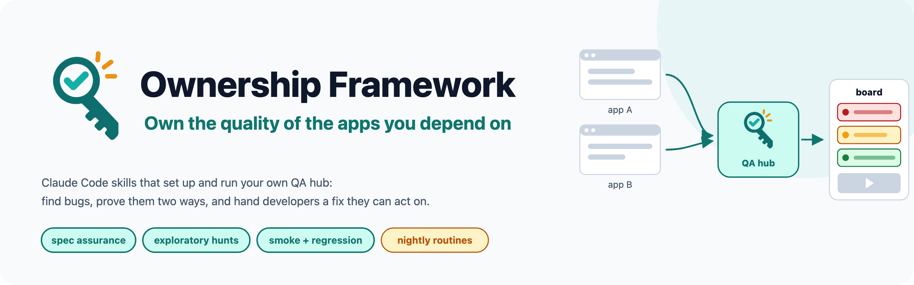
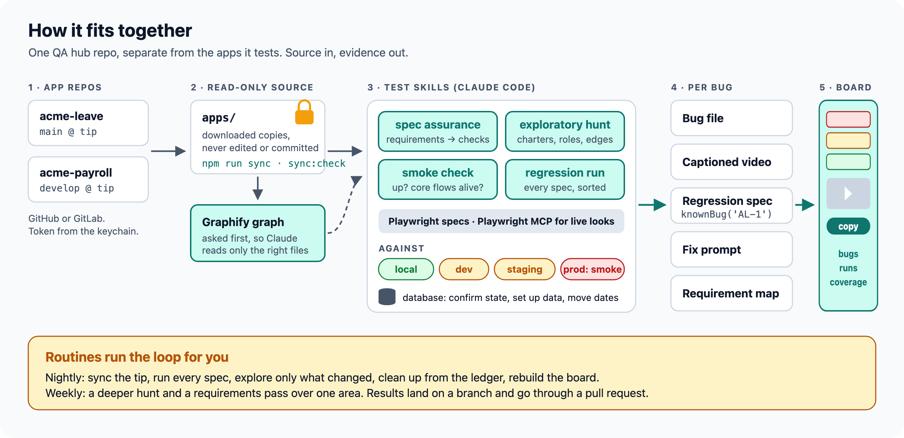
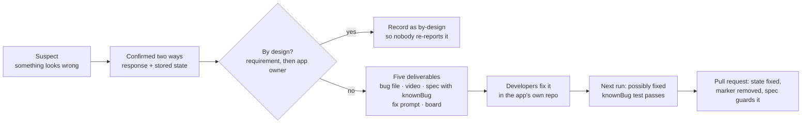
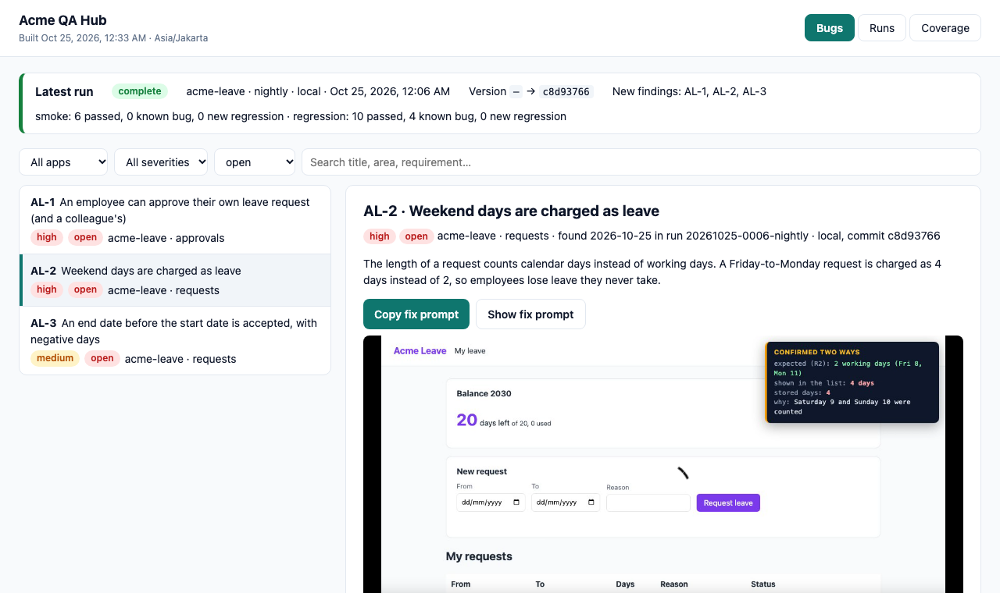
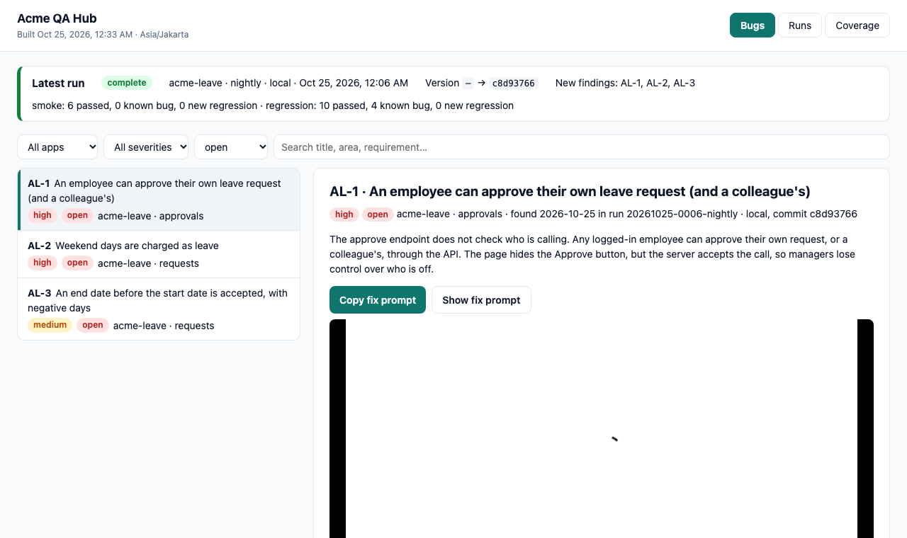
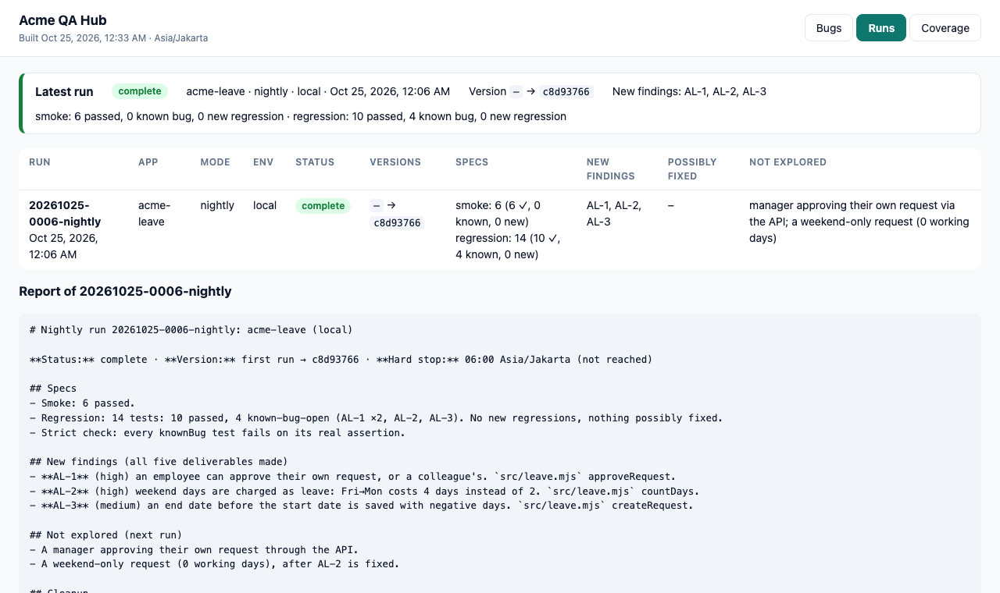
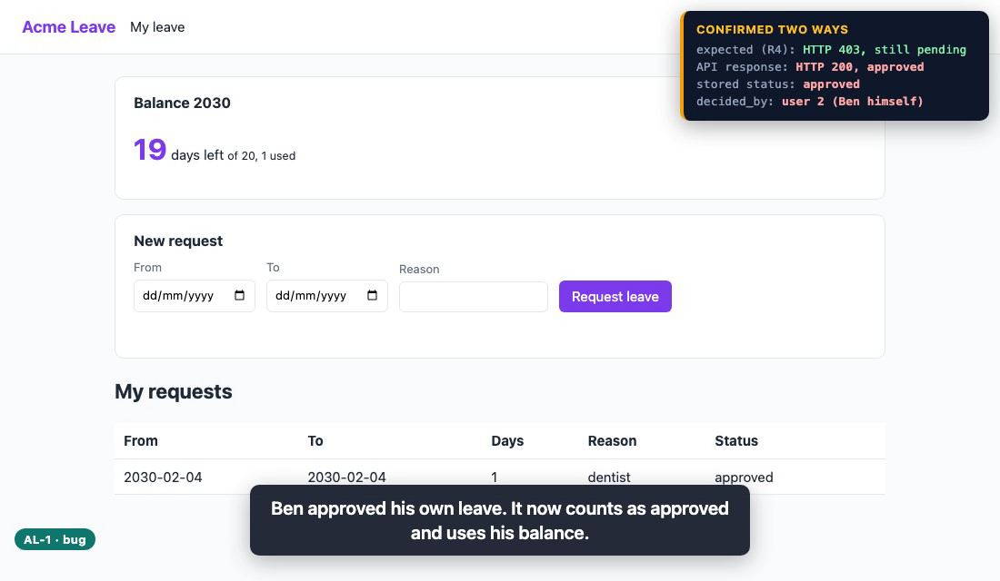
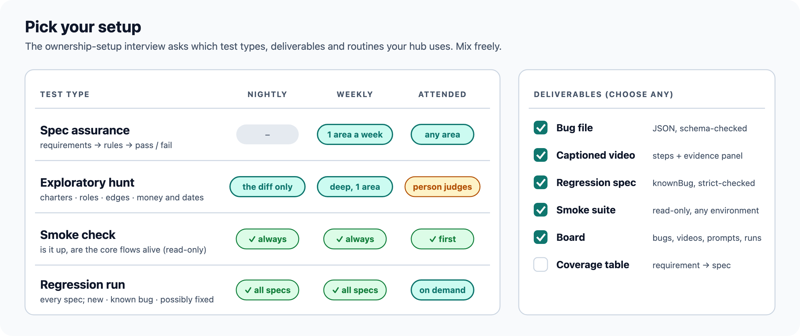
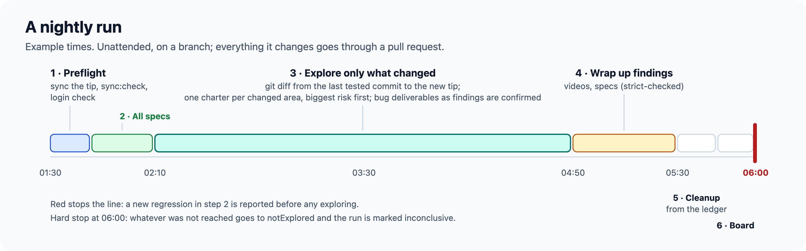
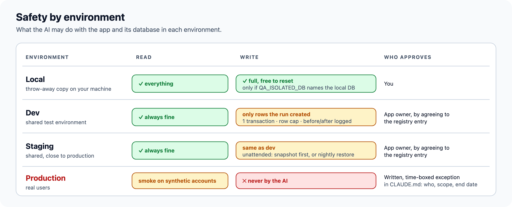

<picture>
  <source media="(prefers-color-scheme: dark)" srcset="docs/visuals/out/hero-dark.png">
  
</picture>

**Claude Code skills that set up and run your own QA hub**: a git repo, separate from the apps it tests, that
holds the bugs, captioned videos, test specs, run status and a results board for one or more web apps. Built so
that one person, even one who does not program, can own the quality of the apps they depend on.

## Try it in 3 commands

Runs offline against the included demo app, **Acme Leave** (fictional), with three seeded bugs. Needs Node 22.13 or
newer and git.

```sh
git clone https://github.com/RickySaif/Ownership-Framework.git && cd Ownership-Framework
npm ci && npx playwright install chromium
npm run example      # syncs the demo app, runs every spec, builds the board
```

Then open `examples/acme-leave/hub/board/index.html` in your browser.

## Use it on your own apps

In Claude Code:

```text
/plugin marketplace add RickySaif/Ownership-Framework
/plugin install ownership-framework@ownership-framework
```

Then say **"set up a QA hub"**. The `ownership-setup` skill asks one plain question at a time (which apps, where
the requirements are, test accounts, environments, which tests and deliverables, routines), generates the hub,
installs Playwright, Playwright MCP, Graphify and ffmpeg, downloads each app's source read-only, runs a first smoke
check and shows you the result.

## How it fits together

<picture>
  <source media="(prefers-color-scheme: dark)" srcset="docs/visuals/out/architecture-dark.png">
  
</picture>

## The five deliverables of a bug

Every confirmed bug ends up as five things, so a developer (or a coding agent) can fix it without a meeting:

1. **Bug file** `qa/<app>/bugs/<ID>.json`: steps, expected (linked to the requirement), actual, where in the code,
   and how it was confirmed: the response **and** the stored state.
2. **Captioned video**: the steps recorded headless, with captions and an evidence panel.
3. **Regression spec** that states the *correct* behaviour, wrapped in `knownBug('<ID>')` so the suite stays green
   until the fix lands, then flips. Each one is proven: in strict mode it must fail on its real assertion.
4. **Fix prompt** for a coding agent: which file and function, why it is wrong, the fix, which spec must turn green.
5. **Board**: everything on one page, with filters, the video, and a copy-fix-prompt button.



<picture>
  <source media="(prefers-color-scheme: dark)" srcset="docs/visuals/out/board-bug-detail-dark.png">
  
</picture>

<table>
  <tr>
    <td width="50%">
      <picture>
        <source media="(prefers-color-scheme: dark)" srcset="docs/visuals/out/board-bugs-dark.png">
        
      </picture>
    </td>
    <td width="50%">
      <picture>
        <source media="(prefers-color-scheme: dark)" srcset="docs/visuals/out/board-runs-dark.png">
        
      </picture>
    </td>
  </tr>
  <tr>
    <td colspan="2">
      
    </td>
  </tr>
</table>

## Pick your setup

<picture>
  <source media="(prefers-color-scheme: dark)" srcset="docs/visuals/out/setup-matrix-dark.png">
  
</picture>

| Skill | What it does |
|---|---|
| `ownership-setup` | **Start here.** Interviews you, generates the hub, installs the tools, runs a first smoke check |
| `spec-assurance` | Turns the requirements into a checklist of testable rules and checks each: pass, fail (bug) or not testable |
| `exploratory-hunt` | Time-boxed bug hunting from charters, as different roles: permissions, validation, states, money and dates, concurrency, empty and error paths |
| `smoke-check` | Fast, read-only "is it up and are the core flows alive", safe on any environment |
| `regression-run` | Runs every spec and sorts failures: new regression, known bug still open, or possibly fixed |
| `bug-report` | Writes the bug file, confirmed two ways and validated against the schema |
| `bug-video` | Records the captioned video with an evidence panel, plus an optional after-fix clip |
| `regression-spec` | Writes the spec of the correct behaviour with `knownBug`, and proves it with strict-check |
| `smoke-spec` | Writes a short, read-only smoke suite per app with its own Playwright config |
| `board` | Builds and publishes the board, with a fix prompt per bug |
| `prd-checklist` | Coverage by requirement: requirement → spec → last result, and the gaps |
| `routine-setup` | Schedules nightly and weekly runs with a least-privilege permissions file |

## A routine on a timeline

<picture>
  <source media="(prefers-color-scheme: dark)" srcset="docs/visuals/out/nightly-timeline-dark.png">
  
</picture>

Routines run as Claude Code scheduled agents (`/schedule`), with cron or launchd on a machine your team owns, or on
a CI schedule. They commit to a branch and open a pull request: changes to specs, `knownBug` markers or bug states
never go straight to main. See [docs/routines.md](docs/routines.md).

## Safety by environment

<picture>
  <source media="(prefers-color-scheme: dark)" srcset="docs/visuals/out/safety-dark.png">
  
</picture>

The tools enforce these rules rather than trusting them: see [docs/safety.md](docs/safety.md).

## What is in this repo

```text
.claude-plugin/        plugin.json and marketplace.json
skills/<name>/         one folder per skill (SKILL.md, plus the hub generator in ownership-setup/)
templates/hub/         what ownership-setup copies into a hub: tools/, lib/, schemas/, board/, playbook/, routines/
examples/acme-leave/   app/: the fictional demo app · hub/: a generated hub with 3 bugs, all deliverables, a run, a board
docs/                  method, safety, routines, FAQ, licensing · visuals/: sources for every image in this README
```

Rebuild every image from source with `npm run visuals`. Run all checks with `npm test`.

## Docs

[Method](docs/method.md) · [Safety](docs/safety.md) · [Routines](docs/routines.md) · [FAQ](docs/faq.md) ·
[Licensing](docs/licensing.md) · [Contributing](CONTRIBUTING.md) · [Security](SECURITY.md) ·
[Changelog](CHANGELOG.md)

## Licence

Code: [MIT](LICENSE). Method, docs and diagrams: [CC BY 4.0](LICENSE-docs). The name, logo and certification titles
are trademarks and are not covered by either licence: see [TRADEMARKS.md](TRADEMARKS.md). © 2026 Ricky Saif.
